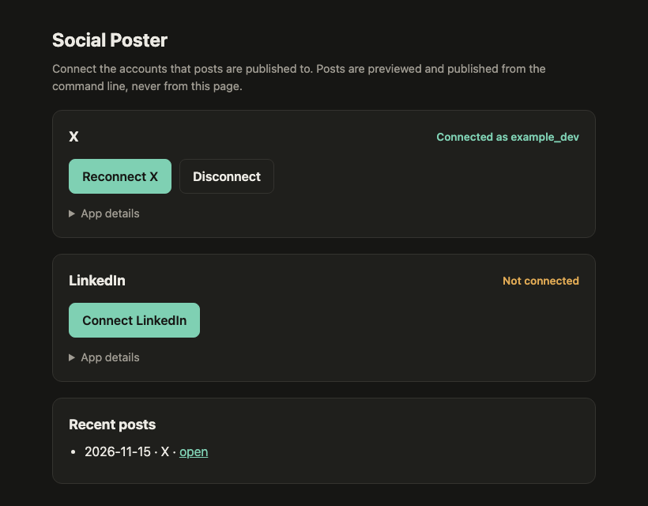

# Social Poster

Preview one draft as it would appear on X and on LinkedIn, then publish to both only after you confirm that exact content.

It has two parts:

- **A connect page** — a small local web page where you save each platform's app credentials and sign in.
- **A command-line tool** — `preview` shows the final text per platform and prints a confirmation code; `publish` posts only when given that code.



## Status and limitations

Working and covered by tests against simulated X and LinkedIn responses. **It has not yet been run against the live X or LinkedIn APIs**; treat the first real post as the acceptance test.

- Posts are text with an optional link and one optional image (PNG, JPG, GIF or WEBP, up to 5 MB). No video, threads, polls, scheduling or analytics.
- X charges per request. On 15 November 2026 its [pricing page](https://docs.x.com/x-api/getting-started/pricing) listed $0.015 per post and $0.20 per post that contains a link. Check the current rate before relying on it.
- X counts characters by its own rules. The preview's count is a close approximation (links count as 23, emoji as 2); X has the final say.
- A LinkedIn sign-in lasts about 60 days. If LinkedIn issues your app a refresh token it is renewed automatically; otherwise you sign in again from the connect page. `status` warns a week ahead.
- LinkedIn posts go to your personal profile, publicly. Company pages are not supported.
- If a platform accepts a post but the reply is lost (for example a timeout), the tool cannot know it was posted. Check the account before retrying.
- Credentials are stored in a plain owner-only file, not encrypted.
- The connect page has no login of its own. Run it on loopback, or behind a proxy that authenticates you.

## Prerequisites

- Node.js 22 or later. There are no npm dependencies.
- An X developer app with credit, from the [X developer console](https://console.x.com).
- A LinkedIn developer app, from [LinkedIn developer apps](https://www.linkedin.com/developers/apps), with the products "Share on LinkedIn" and "Sign In with LinkedIn using OpenID Connect".

You only need the platform you intend to post to.

## Install

```sh
git clone https://github.com/ichen27/social-poster.git
cd social-poster
cp .env.example .env
```

Edit `.env` if you want a different port, data directory or public address.

## Quickstart

1. Start the connect page:

   ```sh
   node --env-file=.env src/main.mjs
   ```

2. Open `http://127.0.0.1:8945`. Under each platform, open "App details": it shows the callback URL to register with that platform and a form for the Client ID and Client Secret.
3. Click **Connect X** and **Connect LinkedIn** and approve each sign-in.
4. Check the result:

   ```sh
   node --env-file=.env src/cli.mjs status
   ```

5. Preview the example draft:

   ```sh
   node --env-file=.env src/cli.mjs preview examples/draft.json
   ```

   Until an account is connected, the preview still prints the text and then lists "X is not connected" under "Cannot publish yet".

6. Publish, using the code the preview printed:

   ```sh
   node --env-file=.env src/cli.mjs publish examples/draft.json --confirm 1a2b3c4d
   ```

X requires an `https://` callback for anything other than a local address, and LinkedIn does too. To sign in from another device, serve the connect page over HTTPS and set `PUBLIC_URL` to that address.

## Usage

### Draft file

```json
{
  "to": ["x", "linkedin"],
  "text": "Text used for every platform that has no text of its own.",
  "x": { "text": "Shorter text for X only." },
  "linkedin": { "text": "Longer text for LinkedIn only." },
  "link": "https://github.com/example/project",
  "image": "screenshot.png",
  "imageTitle": "Optional title LinkedIn stores with the image"
}
```

- `to` is required. `text`, or a per-platform `text`, is required for each platform listed.
- `link` is appended on its own line unless the text already contains it.
- `image` is resolved relative to the draft file.

### Commands

| Command | What it does |
| --- | --- |
| `status [--json]` | Shows whether each account is connected and when to sign in again. Never prints a secret. |
| `preview <draft>` | Prints the final text per platform, character counts, any problems, and a confirmation code. Contacts no platform. |
| `publish <draft> --confirm <code>` | Posts. Refuses if the code does not match the draft as it is now. |

Options for `preview` and `publish`:

- `--allow-long` skips the 280-character check for X accounts that can post long posts.
- `--allow-duplicate` posts content that the history shows was already posted.

Exit codes: `0` success, `1` the draft has problems or a post failed, `2` wrong usage.

### Safety behaviour

- **Nothing posts without a matching code.** The code is derived from the final text of every target and the image bytes, so editing the draft after a preview invalidates it.
- **Retries are safe.** Each successful post is recorded. If one platform fails, running the same `publish` again skips the platform that already succeeded.
- **Failures are separate.** One platform failing does not stop the other; the exit code is non-zero and the failing platform is named.

## Validation

```sh
bash ci/run.sh
```

This runs the test suite (`npm test`) and a syntax check of every source file (`npm run check`). Tests use simulated platform responses and temporary directories; they need no credentials and post nothing. The same script runs on GitHub-hosted runners for every pull request.

## What is in this repository

| Path | Purpose |
| --- | --- |
| [src/cli.mjs](src/cli.mjs) | The `status`, `preview` and `publish` commands |
| [src/post.mjs](src/post.mjs) | Draft validation, the confirmation code, publishing and retry behaviour |
| [src/x.mjs](src/x.mjs), [src/linkedin.mjs](src/linkedin.mjs) | The calls made to each platform |
| [src/server.mjs](src/server.mjs) | The connect page |
| [examples/draft.json](examples/draft.json) | A sample draft, with [its image](examples/screenshot.png) |
| [docs/screenshots/connect-page.png](docs/screenshots/connect-page.png) | The connect page with demo data |
| [docs/design.md](docs/design.md) | Why it is built this way |
| [launcher.json](launcher.json) | The author's own deployment manifest; not needed to run the tool |

## Contributing and issues

See [CONTRIBUTING.md](CONTRIBUTING.md). Report problems through GitHub Issues, and never include a token, client secret or the contents of `credentials.json`.

## License

No license has been chosen yet, so all rights are reserved. A license will be added before this repository is made public.
